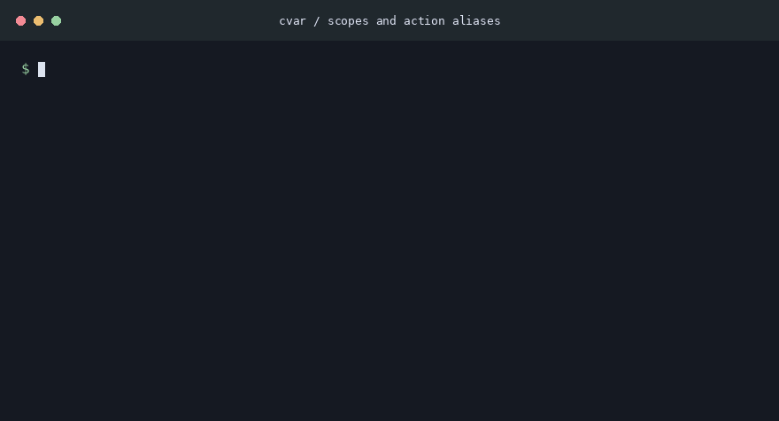
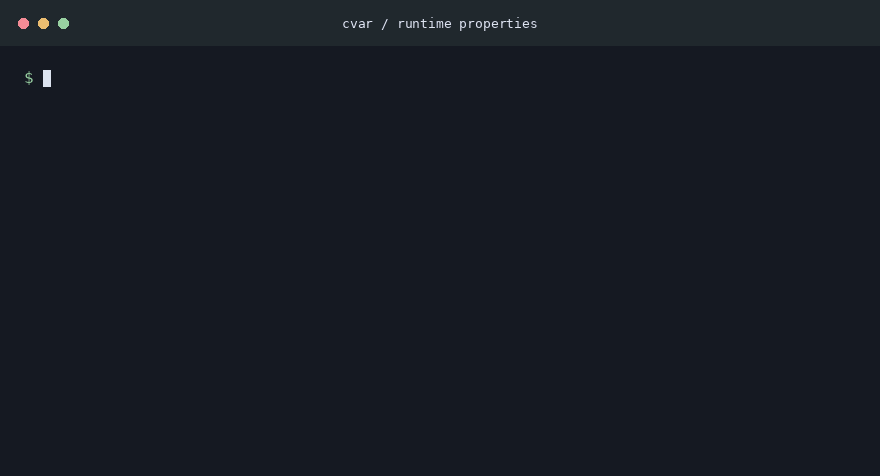

Configuration Variables
=======================

[](https://opensource.org/licenses/MIT)
[](https://crates.io/crates/cvar)
[](https://docs.rs/cvar)
[](https://github.com/CasualX/cvar/actions)

Configure program state through stringly typed API.

Demonstration
-------------

These terminal recordings show how properties and actions interact with live program state.

### Properties and actions


### Scopes and action aliases



### Runtime properties



Introduction
------------

When an application does a particular job and exits, configuration can be loaded at startup and stored in a dedicated configuration object.

When an application is long-lived this may not suffice, it may want to have:

* Its configuration changed one setting at the time.
* Complex hierarchical organization of the configuration.
* An interface where the state of the configuration can be queried and updated.
* Executable actions instead of just variables.
* Addon support which needs its own configuration mounted under a prefix.
* Support dynamic configuration created at runtime.

Usage
-----

This crate is on [crates.io](https://crates.io/crates/cvar), documentation is on [docs.rs](https://docs.rs/cvar).

In your Cargo.toml:

```text
[dependencies]
cvar = "0.5"
```

For `no_std` applications, disable the default `std` feature:

```toml
[dependencies]
cvar = { version = "0.5", default-features = false }
```

The crate uses `alloc` for strings, owned properties, and REPL operations.
The optional `type_name` feature also works without `std`.

Examples
--------

For more examples on specific topics and techniques, see [the examples](examples).

The following code explains how the ProgramState demonstration is implemented.

```rust
pub struct ProgramState {
	number: i32,
	text: String,
}

impl ProgramState {
	pub fn poke(&mut self, args: &str) {
		self.text = format!("{}: {}", args, self.number);
	}
}
```

Start by defining the state to be made interactive.
This is ordinary Rust code, the idea is that you have some long-lived state that needs to be interactive through a stringly typed API.

```rust
impl cvar::IVisit for ProgramState {
	fn visit(&mut self, f: &mut dyn FnMut(&mut dyn cvar::INode)) {
		f(&mut cvar::Property("number", &mut self.number, &42));
		f(&mut cvar::Property("text", &mut self.text, &String::new()));
		f(&mut cvar::Action("poke!", |args, _context| { self.poke(args); Ok(()) }));
	}
}
```

The next step is to implement the `IVisit` trait.
This trait lies at the heart of this crate's functionality.

Its `visit` method allows callers to discover the interactive elements of the structure.
Call the closure with all the interactive elements wrapped in a 'node' type such as a `Property` or an `Action`.

Note the ephemeral nature of the nodes, this plays very well into Rust's ownership model and avoids battles with the borrow checker as the nodes temporarily wrap around the underlying variables and methods.

```rust
let mut program_state = ProgramState {
	number: 42,
	text: String::new(),
};
```

Given unique access to the program state...

```rust
assert_eq!(cvar::repl::get(&mut program_state, "number").unwrap(), "42");

let mut context = String::new();
assert_eq!(cvar::repl::set(&mut program_state, "number", "13", &mut context), Ok(true));
assert_eq!(program_state.number, 13);
```

Get or set properties by their textual names and values through a console like interface.

```rust
let mut context = String::new();
cvar::repl::invoke(&mut program_state, "poke!", "the value is", &mut context).unwrap();
assert_eq!(program_state.text, "the value is: 13");
```

Invoke methods through actions defined in the visitor.

Design
------

Configuration is the interface where a user meets and interacts with the program state. Users interact through text while programs have their preferred data types.

The goal of a configuration manager is to facilitate this interaction. This library's scope is more narrow in providing just the means to identify configurable elements and interact with them through text.

A configurable element is called a _node_. Every _node_ has a _name_. There are three types of nodes: _properties_, _lists_ and _actions_.

* A _property_ stores a variable and has a _default value_.

* A _list_ defines a hierarchy. It contains _child nodes_. Names in a hierarchy are separated by a dot, eg: `list.foo`.

* An _action_ is node that can be invoked with an argument string. It can execute arbitrary code in its context.

The _nodes_ are ephemeral, this means that they don't store their metadata next to and interspersed with the program state. This avoids requiring long-lived borrows and has other performance benefits.

While generic implementations are provided, each node type is a trait and can have custom implementations.

License
-------

Licensed under [MIT License](https://opensource.org/licenses/MIT), see [license.txt](license.txt).

### Contribution

Unless you explicitly state otherwise, any contribution intentionally submitted
for inclusion in the work by you, shall be licensed as above, without any additional terms or conditions.
